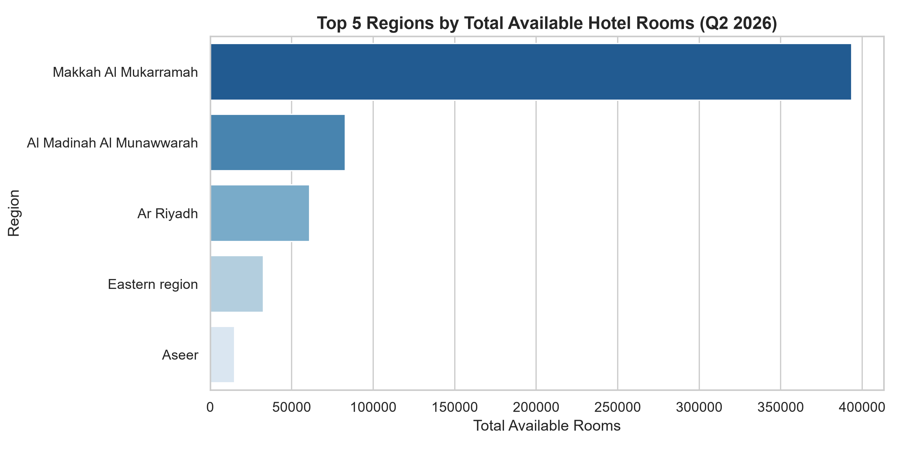
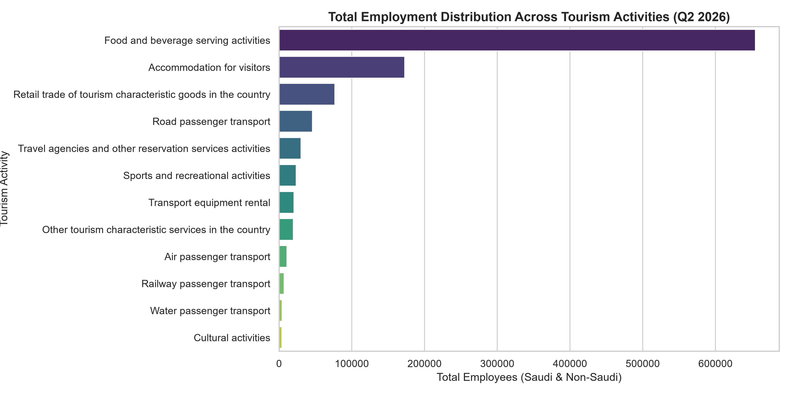
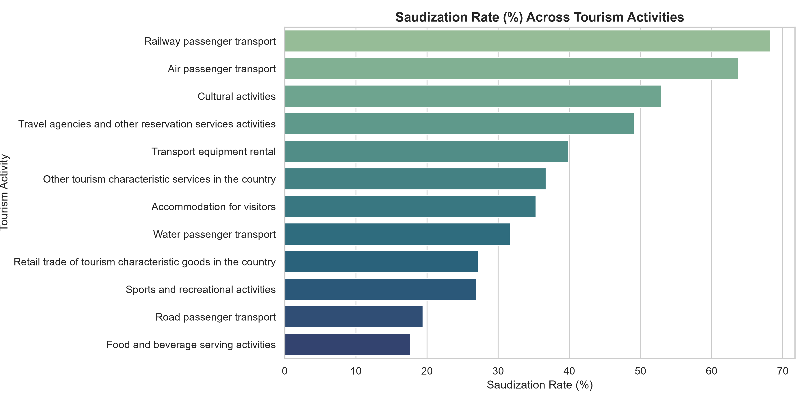

# Saudi Tourism & Hospitality Analytics (Q1 2022 – Q2 2026)

An end-to-end Data Engineering and Business Intelligence project analyzing Saudi Arabia's tourism sector, hospitality capacity, occupancy dynamics, and workforce distribution.

---

## Project Overview
This project processes and models official tourism statistics to uncover strategic insights into regional accommodation capacity, hotel performance (Occupancy Rates, ADR, Length of Stay), and labor market participation across Saudi administrative regions and cities.

---

## Project Architecture & Star Schema
The project follows a rigorous Dimensional Modeling approach (Kimball Methodology):
* Dimension Tables (`Dim_Date`, `Dim_Region`, `Dim_City`, `Dim_Activity`): Storing descriptive attributes and master entities.
* Fact Tables (`Fact_Quarterly_Performance`, `Fact_Regional_Performance`, `Fact_City_Performance`, `Fact_Activity_Performance`): Containing core metrics and foreign keys.

---

## Key Insights & Visualizations

### 1. Regional Hospitality Capacity
* **Makkah Al Mukarramah** leads the Kingdom in total available hotel rooms, driven by heavy religious tourism and seasonal pilgrimage spikes.
* **Al Madinah Al Munawwarah** and **Ar Riyadh** follow closely as major hospitality and business hubs.

### 2. Tourism Workforce & Employment Distribution
* **Food & Beverage serving activities** dominate the sector's employment, accounting for the largest share of total tourism jobs in the country.
* **Accommodation for visitors** represents the second-largest employer segment.

### 3. Quarterly Hotel Occupancy Rate Trends
* Tracks the evolution of hotel occupancy rates across quarters from 2022 through Q2 2026, capturing seasonal tourism peaks and market demand fluctuations.

### 4. Saudization Rate Across Tourism Activities
* Evaluates workforce localization (Saudization percentages) across various tourism activities, aligning with national strategic objectives and Vision 2030 employment goals.

---

## Tech Stack
* Language: Python (`Pandas`, `Matplotlib`, `Seaborn`)
* Data Engineering: Automated Star Schema pipeline (`src/build_star_schema.py`)
* Data Modeling & BI: Power BI (Star Schema design & DAX measures)
* Version Control: Git & GitHub

---

## Author
**Al-Mogdad Al-Tayeb**  
*Senior Data Analyst & BI Developer*  
[GitHub Profile](https://github.com/YOUR_USERNAME) | [LinkedIn](https://linkedin.com/in/YOUR_USERNAME)